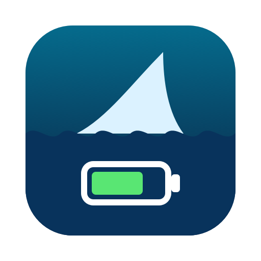

# Attack Shark Battery for Mac

> [!WARNING]
> **This is an AI slop project.** It was written almost entirely by an AI
> coding assistant (Claude Code) in one sitting, with light human review. It
> works on my machine; read the code before you trust it.

A tiny macOS menu bar app that shows the battery level of an Attack Shark
wireless mouse and notifies you when it runs low.

macOS can't see this mouse's battery: the 2.4 GHz receiver (USB `1d57:fa60`)
has no standard battery field. The level is only sent over the receiver's
vendor channel, which this app listens to. It never writes to the mouse or
receiver.

Tested with the Attack Shark G3 Pro. Other Attack Shark mice that use the same
`1d57:fa60` receiver should work too.

## Install

Requires macOS 13 or later and the Xcode Command Line Tools
(`xcode-select --install`).

```sh
git clone https://github.com/GauravJain98/attack-shark-battery-mac.git
cd attack-shark-battery-mac
./install.sh
```

This builds the app, copies it to `~/Applications`, and starts it. Allow
notifications when macOS asks. On first launch it registers itself to start at
login.

To update, `git pull` and run `./install.sh` again.

## Use

- The menu bar shows the battery percentage, with ⚡ while charging, and `–`
  when the mouse is asleep or disconnected.
- **Notify Below** sets the low-battery alert level (10–30%, default 20%). You
  get one notification per discharge; it re-arms once the mouse is charging or
  5% above the level.
- **Start at Login** toggles launching at login.

## Uninstall

Quit it from the menu, turn off **Start at Login** first if you like, then:

```sh
rm -rf ~/Applications/AttackSharkBattery.app
```

## How it works

The receiver pushes a five-byte input report every couple of seconds:

```
03 xx 40 ST NN
         │  └─ battery level, 0–100 (%)
         └──── state: 01 = on battery, 03 = charging
```

Frames where the third byte isn't `40` are link-status noise and are ignored.

The packet format comes from
[Attack Shark Battery KDE](https://gitlab.com/gabriel17166/Attack-Shark-Battery-KDE),
a Linux tray app for the same receiver.

The icon is an original drawing (`tools/make-icon.swift`), not Attack Shark's logo.
This project isn't affiliated with Attack Shark.
